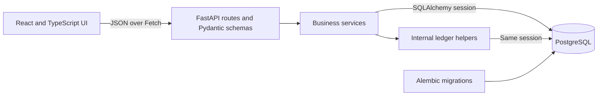

# Architecture

This HSA simulator focuses on the assignment's core flows: creating accounts,
depositing funds, issuing virtual cards, and approving or declining simulated
purchases while keeping balances correct under concurrent requests. It runs
locally and deliberately leaves banking integrations and production identity
management outside scope.

## System overview



The frontend uses Vite and Tailwind CSS. FastAPI runs through Uvicorn and exposes
interactive API documentation at `/docs`. PostgreSQL stores all application data;
SQLAlchemy handles queries and sessions, and Alembic manages schema changes.
Docker Compose runs the frontend, API, and database as separate services.

Routes validate HTTP inputs and map business errors to responses. Services own
business rules and database transaction boundaries. Ledger helpers insert and
query transaction rows using the service's session; they do not commit, define
HTTP routes, or appear independently in `/docs`.

The intended flow is **API route → business service → ledger helper**, with
services also accessing account and card models. For example, transaction history
is exposed through a route and an ownership-checking service that calls the
existing `list_transactions` helper. History is implemented, not just groundwork.

### Frontend state and API access

The application shell holds the selected user and account in memory and shares
them between the dashboard and deposit page. Selecting a different user clears
the account selection; selecting a different account resets the dashboard's local
state. Pending dashboard reads are cancelled when the account changes so an old
response cannot overwrite the new account's data.

A shared Fetch helper handles JSON requests and readable HTTP, validation, and
network errors. The dashboard loads balance, cards, and recent transactions
independently, with loading, empty, error, and retry states. The current account
balance comes from the account-list endpoint; the selector filters that list by
the selected user. These frontend filters are not access control.

The dashboard remains mounted while the deposit page is open. Returning after a
deposit preserves the displayed data until the reviewer uses **Refresh data**;
successful purchases and card actions trigger dashboard reloads. Full Transaction
History and transaction-detail views, deposit history, and a dedicated Concurrent
Purchase Demo UI remain planned features rather than implemented pages.

## Data model

All tables use integer primary keys. These are easy to read and type during local
development, API testing, and debugging. Distributed ID generation and opaque
public identifiers are not needed for this assignment; integer IDs are not an
access-control mechanism.

| Table | Purpose and important fields |
| --- | --- |
| `users` | Name, unique normalized email, and creation timestamp. A user can own multiple accounts. |
| `accounts` | User reference, current `balance_cents`, and creation timestamp. New accounts start at zero. |
| `debit_cards` | Account reference, cardholder, simulated last four digits, expiration date, status, and creation timestamp. An account can retain several historical cards. |
| `transactions` | Account reference, optional card reference, positive amount, signed balance change, category, type, outcome, decline reason, timestamp, idempotency key, and request hash. |

Pydantic's `EmailStr`, backed by the `email-validator` dependency, handles email
validation. Input is trimmed and lowercased before storage, and the database
rejects duplicate emails. This is simpler than maintaining a custom email parser;
it does not verify mailbox ownership.

### Money and reconciliation

Money uses integer USD cents in the API, services, and database. The UI parses
dollar strings into cents using integer arithmetic and formats cents for display.
Floating-point arithmetic is not used to calculate financial changes.

`amount_cents` is always positive; `balance_change_cents` represents actual impact:

| Outcome | Amount | Balance change |
| --- | --- | --- |
| Approved deposit of $100 | `10000` | `10000` |
| Approved purchase of $80 | `8000` | `-8000` |
| Declined purchase of $50 | `5000` | `0` |

For operations performed through the services, the intended invariant is:

```text
account.balance_cents = SUM(account transactions' balance_change_cents)
```

Storing a balance avoids summing the entire ledger for every authorization. The
cost is maintaining two representations consistently: services update both in one
database transaction, and tests compare the stored balance against the ledger.
There is no database trigger enforcing this aggregate equality against direct SQL.

Each deposit and purchase is limited to $1 trillion as a simple simulator guardrail,
not an HSA contribution limit. Balances use signed PostgreSQL `BIGINT`, whose maximum
positive value corresponds to $92,233,720,368,547,758.07. Deposits conditionally check
remaining capacity before incrementing the balance. The UI has a lower exact-display
limit because JSON numbers become JavaScript numbers; it shows a precision warning
for balances outside the safe integer range. Aligning these limits is future work.

### One transaction table also serves as the ledger

One table supports the activity feed, audit history, and reconciliation. Each new
financial outcome needs one transaction-row insert, alongside any balance update.
Business declines are retained with zero balance impact. Invalid request bodies
and missing or mismatched account/card references return errors without ledger rows.

This keeps the implementation small but combines purchase attempts with money
movement. Holds, settlement, and refunds would benefit from separate transaction
or authorization records and ledger entries, potentially using double-entry
accounting. The current model is not a double-entry ledger.

### Invariants and enforcement

| Invariant | Enforcement |
| --- | --- |
| Account balance never becomes negative | Conditional debit and database check constraint. |
| Balance matches the sum of ledger changes | Services commit balance and ledger changes atomically; reconciliation tests verify equality. No aggregate database constraint enforces this against arbitrary writes. |
| Deposits and purchases have positive amounts | Strict request validation and a positive-amount database check constraint. |
| Approved deposits add their amount; approved purchases subtract it; declines have zero impact | Service logic and a database outcome constraint linking type, status, amount, balance change, and decline reason. |
| An approved purchase uses an active, unexpired card and qualified category | Server-side business checks performed while the account is locked. |
| A purchase card belongs to its account | Account-scoped card lookup and a composite card/account foreign key. |
| New accounts start at zero | Account creation omits the balance; the database default is zero. |
| At most one card per account has stored `ACTIVE` status | Account locking during issuance and a partial unique index. |
| One account-scoped idempotency key cannot create multiple financial operations | Request-hash comparison, unique constraint, and transaction/replay handling. |
| Existing transaction rows are not edited through application flows | Append-only ledger helpers and no update/delete endpoints; not database-enforced immutability. |
| Account-specific operations validate the supplied user/account relationship | Service ownership checks; selected-user mode does not authenticate the caller. |

## Request flows

### Implemented API surface

In this table, `{account_path}` means
`/users/{user_id}/accounts/{account_id}`.

| Method | Path | Purpose |
| --- | --- | --- |
| `GET` | `/health` | API process health. |
| `GET` | `/users` | List simulator users. |
| `POST` | `/users` | Create a user. |
| `GET` | `/accounts` | List all simulator accounts. |
| `POST` | `/users/{user_id}/accounts` | Create an account for a user. |
| `GET` | `{account_path}/cards` | List all cards for an account, newest first. |
| `POST` | `{account_path}/cards` | Issue a virtual card. |
| `POST` | `{account_path}/cards/{card_id}/deactivate` | Deactivate a card. |
| `POST` | `{account_path}/deposits` | Deposit funds. |
| `POST` | `{account_path}/purchases` | Simulate a purchase. |
| `GET` | `{account_path}/transactions` | List transactions newest first, with `limit` (1–100, default 100) and nonnegative `offset`. |

The interactive schemas are available at `/docs`. Individual-user,
individual-account, and transaction-detail GET routes, and a PATCH-card route,
are not currently implemented.

### Create an account and issue a card

A reviewer creates or selects a simulated user, then creates an account belonging
to that user. A card-issuance request supplies the cardholder name. The service
locks the account, deactivates expired active cards, checks for an existing active
card, and inserts simulated card details. A partial unique index independently
enforces at most one `ACTIVE` card per account.

Cards expire on the last day of the issuance month three years later. This is a
simple simulation policy inspired by a typical debit-card lifespan, not a network
requirement. Expiration checks use the UTC date; a card is valid through its
expiration date. Expired active cards are changed to inactive during issuance or
purchase processing when the operation commits. There is no scheduled expiration
job, and listing cards does not mutate them. The UI checks expiration separately
from stored status. Explicit deactivation is supported; reactivation is not.

### Deposit funds

1. The UI validates a positive dollar amount and converts it to integer cents.
2. `POST /users/{user_id}/accounts/{account_id}/deposits` validates the body and
   required `Idempotency-Key` header.
3. The service verifies account ownership and checks for a previous matching operation.
4. A conditional SQL update increments the balance only if it fits within the
   maximum balance. The service appends an approved deposit using the same session.
5. Both changes commit together. Any failure before commit rolls back both changes.

The page displays the saved amount and transaction ID. Deposit history, automatic
dashboard refresh after depositing, and a deposit retry workflow are deferred.
The dashboard's manual refresh loads persisted balance and history changes.

### Process a purchase

The request supplies `card_id`, positive `amount_cents`, category, and an
`Idempotency-Key`. Within one database transaction, the service:

1. Locks the account and verifies that it belongs to the selected user.
2. Processes expired cards and checks for an idempotent replay.
3. Finds and locks the supplied card within that account.
4. Checks expiration, active status, and the qualified-category allowlist.
5. For an eligible purchase, conditionally subtracts the amount only if sufficient
   funds remain. Otherwise, it records an insufficient-funds decline.
6. Inserts an approved or declined transaction and commits atomically.

Qualified categories include pharmacy, hospital, doctor visits, prescriptions,
dental, vision, over-the-counter medicine, and preventative care. Restaurant,
movies, and electronics are invalid. Qualification is decided on the server by
category, not by individual items or medical documentation.

Business declines return a transaction response, not an HTTP validation failure.
The UI therefore inspects transaction status and decline reason. Missing resources
return `404`, invalid inputs return `422`, and idempotency conflicts return `409`.

## Concurrent transactions and retries

Correctness depends on PostgreSQL, not an in-memory Python lock. Purchases and card
changes acquire the account row lock before card locks. Conflicting operations on
one account wait for one another, while unrelated accounts can proceed independently.
The account lock is acquired before purchase replay and eligibility checks.
Operations can lock multiple rows, including cards updated during expiration
processing; the policy is consistent account-before-card ordering, not a limit
of one locked row per operation.
The purchase's conditional debit and the database's nonnegative-balance constraint
provide additional protection. Deposits use an atomic SQL increment, which also
acquires a row lock and coordinates with competing balance updates.

For the assignment's example, start with $100 and submit qualified $80 and $50
purchases concurrently. If $80 commits first, $20 remains and $50 is declined.
If $50 commits first, $50 remains and $80 is declined. The winner is not guaranteed;
only one can be approved, and the balance cannot become negative. A failed ledger
insert also rolls back the corresponding debit or deposit.

Serializing operations per account is a deliberate simplicity tradeoff. It reduces
throughput on a very busy account but makes the consistency rules easier to reason
about and is sufficient for this local simulator.

Idempotency keys are unique per account across deposits and purchases. A SHA-256
hash of the normalized operation payload distinguishes a replay from reuse for a
different request. A matching replay returns the original outcome without applying
another balance change; a different payload returns a conflict. New outcomes return
`201`; replays return `200`.

| Request case within an account | Result |
| --- | --- |
| New key and valid request | Process a new operation, subject to eligibility, funds, and balance limits. |
| Same key and same payload | Return the original outcome without moving money again, including a prior business decline. |
| Same key and different payload | Return `409` without applying another operation. |
| Concurrent requests with the same key | Apply at most one operation; matching requests retrieve the same outcome, while conflicting payloads are rejected. |
| Separate requests with different keys | Treat them as separate operations; each still must pass validation and business checks, so both purchases are not necessarily approved. |

Concurrent duplicate deposits can both initially miss the prior entry. The unique
constraint allows only one to commit; the losing transaction rolls back its balance
increment, then retrieves and checks the committed entry. Purchases check replay
state after acquiring the account lock. The purchase UI retains the original body
and key for retries with unknown outcomes. Deposit requests include a key but have
no retry workflow; unknown outcomes are reported without automatic resubmission.

## Ledger immutability

The chosen protection is an append-only repository API and no HTTP update/delete
operations for transaction rows. It is quick to implement and keeps the audit path
clear within the assignment's time limit. It does not stop direct SQL or another
code path with write access from modifying history.

A PostgreSQL trigger rejecting updates and deletes would add database-level
protection, at the cost of database-specific logic and migration maintenance.
Compensating entries would support corrections without changing historical rows;
they complement immutability enforcement rather than replacing it. Refunds are not
implemented. A future refund would append a positive balance-changing entry linked
through a `reverses_transaction_id`, with new refund rules and constraints, instead
of editing the original purchase.

## Local operation and verification

Docker Compose initializes the schema through a one-time migration service using
the backend build configuration and database URL. Startup follows:
**Postgres healthy → `alembic upgrade head` succeeds → backend healthy → frontend**.
The backend depends on successful migration completion, so migration failures
block it from starting. A successful migration container exits with code 0;
subsequent Compose starts can apply pending revisions without resetting data.
Migrations run separately from API processes to avoid each worker trying to
initialize the schema. This local startup design does not coordinate simultaneous
deployments from multiple Compose invocations.

For local Uvicorn development, apply migrations manually before serving requests,
as documented in [README.md](README.md). The `/health` endpoint checks process
availability only, not database or schema readiness. CORS permits the configured
local frontend origin.

Backend integration tests run against a migrated disposable Postgres database.
They cover validation, qualification, card state, ownership checks, idempotency,
rollback, history, and balance/ledger reconciliation. Concurrent tests use
`ThreadPoolExecutor` and a barrier to launch two independent requests together,
then inspect committed results through a fresh connection. Worker threads create
overlapping requests for the test; database locks provide application correctness.
The overspending test uses two $80 purchases against $100 and expects one approval,
one decline, and a $20 balance. Another test verifies duplicate concurrent deposits
apply only once.

The latest repository review ran 197 passing backend tests and a successful
TypeScript/production build. There is no committed frontend interaction test suite;
browser walkthroughs and fresh-database setup checks remain separate verification
steps. Test fixtures migrate their own database and do not prove startup applies
migrations through the Compose dependency chain. A fresh-stack smoke test checks
that startup path separately from the integration-test fixtures.

## Scope and future improvements

Selected users replace authentication for local evaluation. Services validate the
supplied user/account relationship, but callers can choose another user ID and
listing endpoints expose simulator data. This is not production access control.

The simulator assumes immediate deposits, no holds or settlement delay, no refunds,
no external banking or card network, and no contribution limits, investments,
interest, fees, tax reporting, or medical-record storage.
HDHP eligibility is assumed rather than verified, employer contributions are
outside scope, and accounts have no separate active/inactive lifecycle.

With more time, priorities would be browser flow tests, improved deposit feedback
and retries, full history navigation, and a fresh-start setup smoke test. A
production extension would additionally need authenticated identity and authorization,
stronger ledger immutability, explicit refund/settlement modeling, and operational
monitoring and reconciliation.
